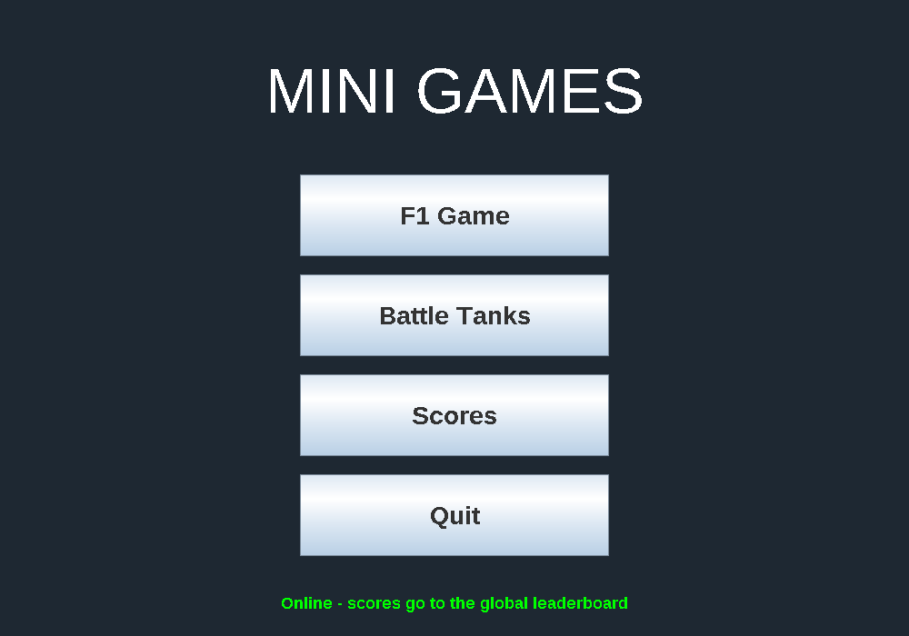
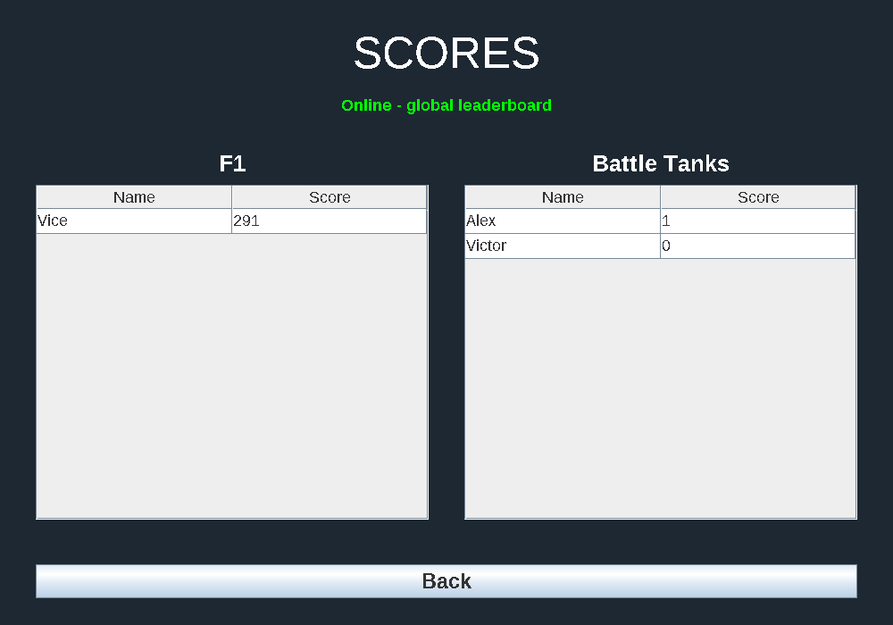
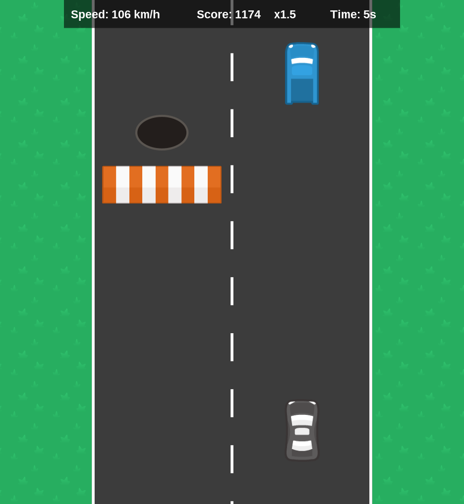
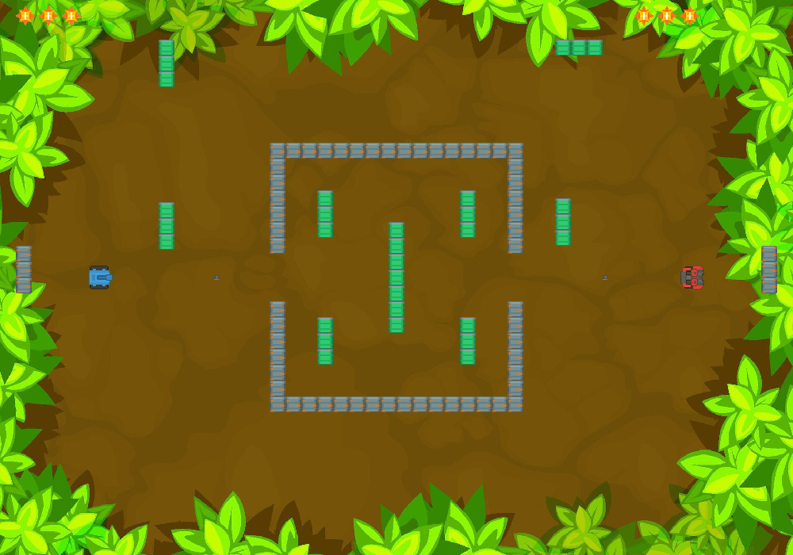

# 🎮 Minigames

A Java Swing game collection with two game modes, **F1 Racing** and **Tank Battle**, plus online leaderboards powered by Supabase.

Built as a university Java project.

---

## 📸 Screenshots

| Main menu | Scores |
|---|---|
|  |  |

| F1 Racing | Battle Tanks |
|---|---|
|  |  |

---

## 👥 Team

| Member | GitHub | Role |
|---|---|---|
| Vice | [@Vice20-05](https://github.com/Vice20-05) | Project manager, repo owner, F1 Racing, database (Supabase) |
| Colleague | [@bellamusulin-del](https://github.com/bellamusulin-del) | Tank Battle, main menu, leaderboard screen |

---

## 🕹️ Game Modes

### 🏎️ F1 Racing
A top-down scrolling racer. Dodge traffic, survive as long as possible and rack up points.

- Traffic spawns randomly in lanes, and there's always at least one open lane
- Speed multiplier: the faster you drive, the more points you earn
- Near-miss bonuses for close calls without crashing
- Roadblocks and potholes appear after 1,000 points
- Difficulty ramps up over time, then levels off so it stays beatable

### 💥 Tank Battle
A local 2-player tank fight on a destructible battlefield.

- Block elements are placed on the field at the start of the game
- Both players can place extra blocks as obstacles and cover
- Bullets ricochet off walls, so bank shots are possible
- Defeat the other player's tank to win

---

## ⌨️ Controls

**F1 Racing**

| Key | Action |
|---|---|
| Arrow keys / WASD | Steer and control speed |
| Enter (game over) | Save your name and score |
| R (game over) | Restart without saving |
| Esc (game over) | Back to main menu without saving |

**Tank Battle**

| Player | Move | Shoot |
|---|---|---|
| Player 1 | W, A, S, D | Left Shift |
| Player 2 | Arrow keys | Right Shift |

---

## 🏆 Leaderboards

- Each game mode has its **own leaderboard**
- Scores are saved online in **Supabase** (PostgreSQL)
- The Scores screen shows both leaderboards side by side: player name and score, highest first (top 10)
- The game checks the connection at startup. The menu shows **Online** or **Offline**
- If there's no internet connection, the games still work and scores are saved in a local SQLite database (`scores.db` in the `.minigames` folder in your home folder). The Scores screen then shows those local scores with an **Offline** label (offline scores are not uploaded later)
- The built game connects by itself: `build.sh` puts the login of a **limited** database user inside the jar (it can only read and save scores, see `docs/supabase_game_user.sql`)

---

## 🎵 Music

- Each screen has its own song: the menu, F1 Racing and Battle Tanks
- The **Music** volume slider and the **Mute** button are on the main menu and count for all three
- The setting is remembered (`settings.properties` in the `.minigames` folder)
- The songs are WAV files in `resources/sounds`: `monkeys.wav` (menu), `mario.wav` (F1 Racing), `bowser.wav` (Battle Tanks)

---

## 📁 Project Structure

```
Minigames/
├── src/
│   ├── f1/              # F1 Racing game
│   ├── battletanks/     # Tank Battle game
│   └── common/          # Main menu, scores screen, database
├── resources/
│   ├── textures/
│   │   ├── f1/          # F1 images
│   │   └── battletanks/ # Tank Battle images
│   ├── sounds/          # Menu, F1 and Tank songs (WAV)
│   └── music/           # earlier CC0 songs + CREDITS.txt (not played anymore)
├── lib/                 # PostgreSQL + SQLite JDBC drivers
├── docs/
│   ├── screenshots/     # Images used in this README
│   └── supabase_game_user.sql  # the limited database user for builds
├── launchers/           # run.bat, run.sh, run.command (go into the release zip)
├── build.sh             # makes the release jar + zip
├── HOW_TO_PLAY.txt      # goes into the release zip
├── config.example.properties
└── README.md
```

---

## 🎮 Play the game

You only need **Java 21 or newer**. Don't have it? Install it free from [adoptium.net](https://adoptium.net) (Temurin 21 or newer).

1. Go to the [Releases page](https://github.com/Vice20-05/Minigames/releases) and download **`Minigames.zip`** from the newest release.
2. Unzip it. You get a `Minigames` folder; keep its files together.
3. Start the game:

| Computer | How to start |
|---|---|
| **Windows** | Double-click **`run.bat`** (or double-click `Minigames.jar`). If you see "Windows protected your PC": **More info → Run anyway**. |
| **macOS** | Double-click **`run.command`**. It opens a Terminal window; leave it open while playing. The first time, macOS blocks it: go to **System Settings → Privacy & Security**, scroll down and click **Open Anyway**. |
| **Linux** | Double-click **`run.sh`**, or run `./run.sh` in a terminal. |

No setup needed: the game connects to the online leaderboard by itself. Without internet, scores are saved on your computer.

---

## 🛠️ For developers

### Requirements
- **JDK 21 or newer** (a JDK, not only a JRE, so you can compile)
- **NetBeans** or **VS Code** with the Java Extension Pack

### The database file: `config.properties`
Running from the source code needs a `config.properties` file in the project folder (next to this README) with the Supabase login. **Ask the project manager for the values.** Copy `config.example.properties`, rename the copy to `config.properties` and fill in the 3 lines:

```properties
db.url=jdbc:postgresql://<host>:5432/postgres
db.user=<user>.<project_ref>
db.password=<password>
```

> ⚠️ **Never commit `config.properties`.** It's in `.gitignore`. Without it the game still runs, but only offline (scores are saved on your computer).

### NetBeans (step by step, no terminal)

**Get the code**
1. **Team → Git → Clone...**
2. Repository URL: `https://github.com/Vice20-05/Minigames.git`, then **Next**.
3. Tick the **dev** branch, **Next**, pick the folder to save it in, **Finish**.
4. NetBeans says there is no project to open. That's fine, click **Close**.

**Make it a NetBeans project (once)**
1. **File → New Project...**
2. Category **Java with Ant**, project **Java Project with Existing Sources**, **Next**. (The first time, NetBeans may ask to activate Java; let it.)
3. Project Name: `Minigames`. Project Folder: **the cloned `Minigames` folder itself** (the one with this README). **Next**.
4. Source Package Folders: **Add Folder...**, pick the **`src`** folder. Leave Test Package Folders empty. **Finish**.
5. Right-click the project → **Properties**:
   - **Sources**: Source/Binary Format **JDK 21**.
   - **Libraries**: next to Classpath click **+** → **Add JAR/Folder...**, select **both** `.jar` files in the `lib` folder (PostgreSQL and SQLite drivers).
   - **Run**: Main Class **`common.Main`** (use **Browse...**). VM Options: `--enable-native-access=ALL-UNNAMED`. Leave Working Directory empty.
   - **OK**.
6. Put your `config.properties` in the project folder (see above).

**Run it**: click the green **Run Project** button (or **F6**). The main menu opens.

NetBeans makes `nbproject/`, `build.xml` and `manifest.mf` in the folder. They are in `.gitignore`, so they don't get committed. Pictures and music are found automatically from the project folder.

### VS Code
Open the cloned folder, put `config.properties` in it, then run **Launch Main Menu** from the Run and Debug panel (or press `Ctrl+Shift+B`).

### Make a release build
```bash
./build.sh
```
(Linux/macOS terminal, or Git Bash on Windows.) It makes:
- `dist/Minigames.jar`: everything in one file (our code, pictures, music, both database drivers). Double-click starts the main menu.
- `dist/Minigames.zip`: a `Minigames` folder with the jar, `run.bat`, `run.sh`, `run.command` (from `launchers/`) and `HOW_TO_PLAY.txt`. This is what you upload as a GitHub Release.

If `config.properties` exists, a copy goes **inside the jar**, so players are online without any setup. `config.properties` itself never goes to git, and `build/` and `dist/` are in `.gitignore` (never commit the jar or zip). Anyone can unzip a jar, so for builds you share, use the **limited game user** from `docs/supabase_game_user.sql`, never the `postgres` admin password (`build.sh` warns you).

---

## 🌿 Branches

| Branch | Purpose |
|---|---|
| `main` | Stable, final version |
| `dev` | Working version, everything gets merged here first |
| feature branches | One per feature, merged into `dev` through pull requests |

---

## ✅ Requirements Checklist

| Requirement | Status |
|---|---|
| F1 Racing game mode (Java Swing) | ✅ Done |
| Random obstacles and collision avoidance | ✅ Done |
| Tank Battle, 2 players (WASD + Left Shift / Arrows + Right Shift) | ✅ Done |
| Placeable blocks as obstacles and cover | ✅ Done |
| Separate leaderboard per game mode | ✅ Done |
| Scores saved in a database (Supabase) | ✅ Done |
| Leaderboard shows name and score | ✅ Done |
| Global online leaderboard | ✅ Done |
| Core game works without internet | ✅ Done |
| Offline local database (SQLite) | ✅ Done |
